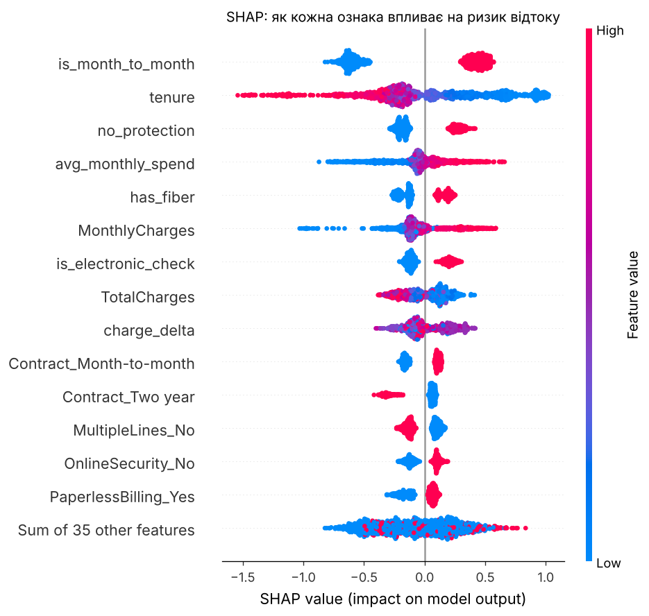
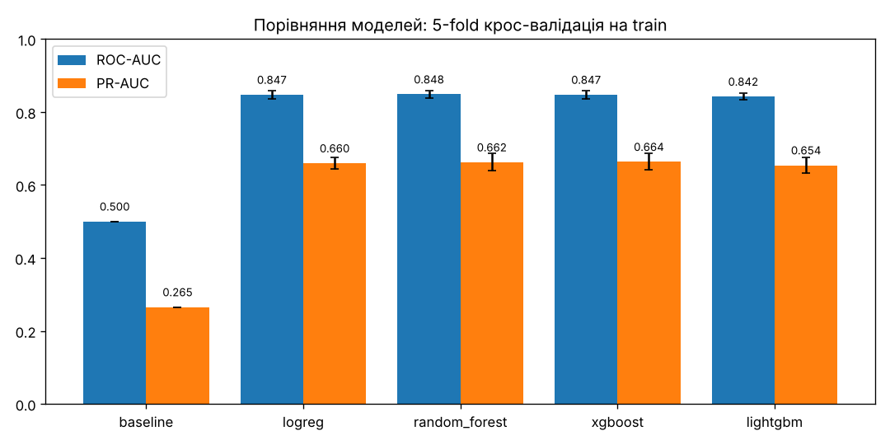
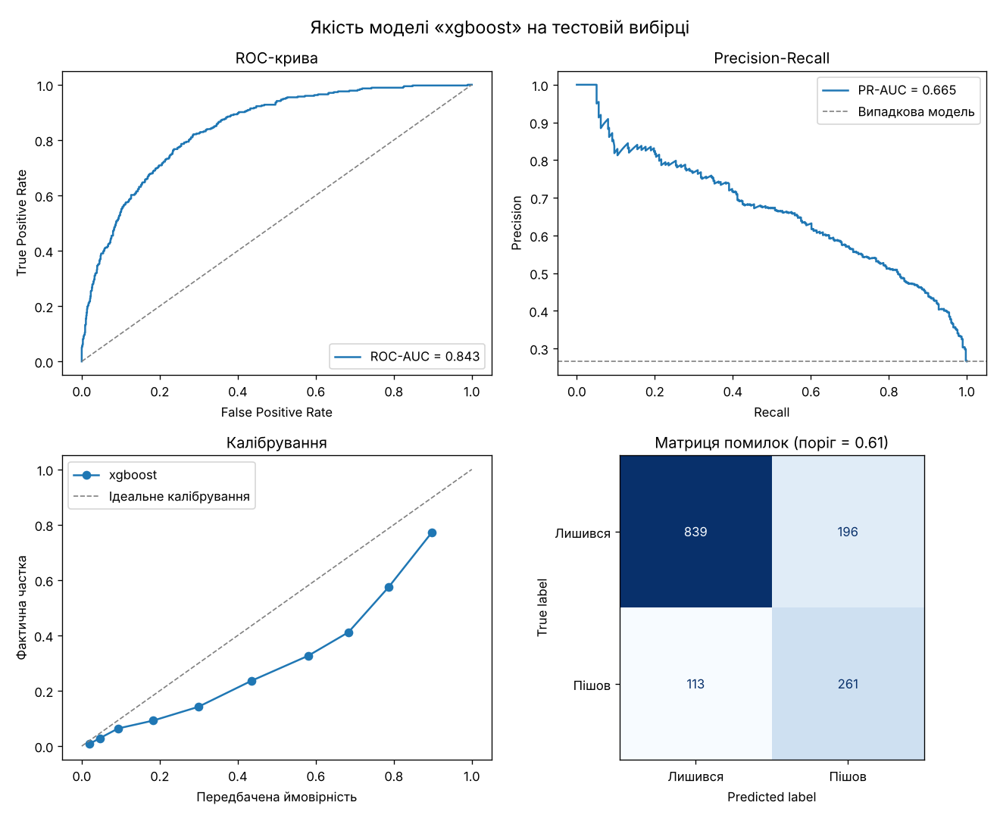
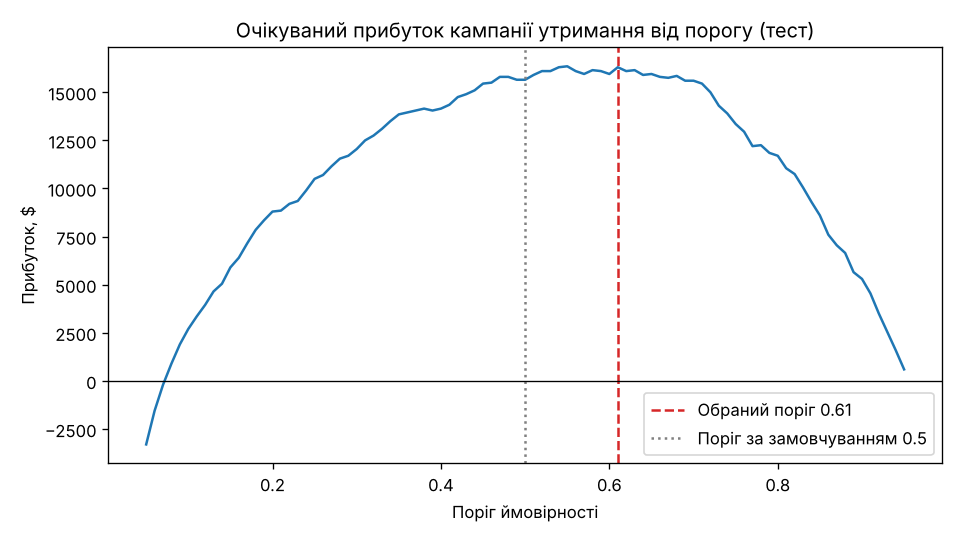
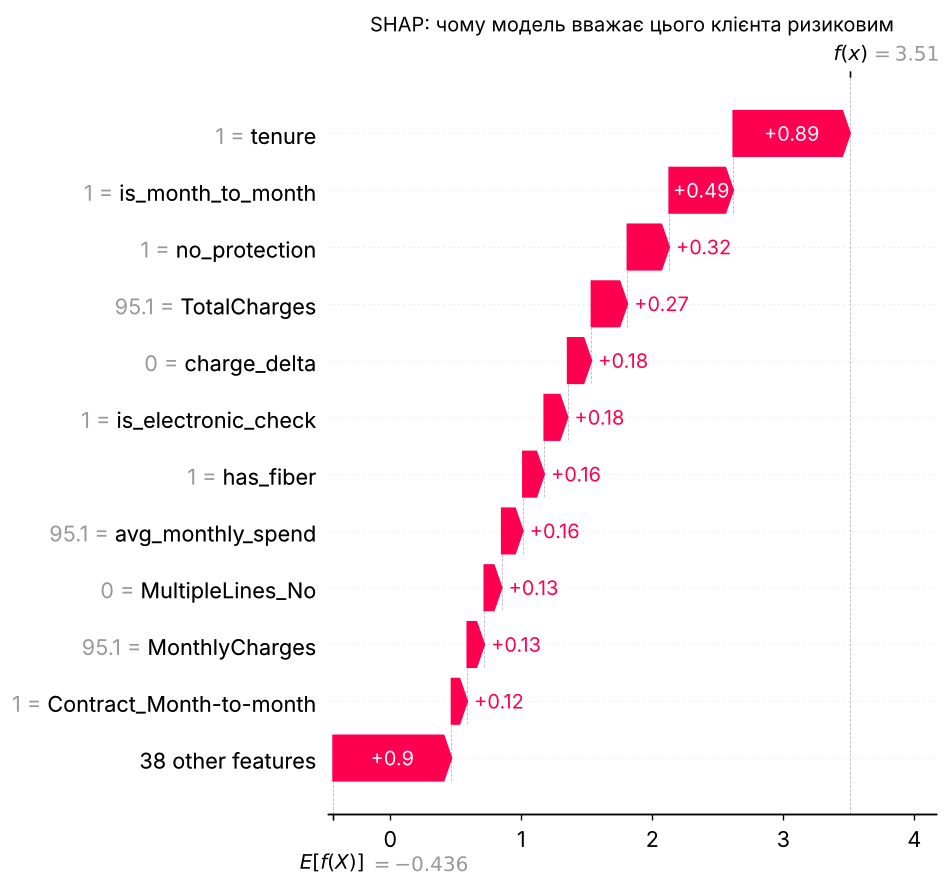

# Прогноз відтоку клієнтів (Customer Churn Prediction)

End-to-end ML-проєкт: від сирого CSV до REST API в Docker. Модель прогнозує, чи піде клієнт
телеком-оператора, **пояснює чому** (SHAP) і обирає поріг рішення за **очікуваним прибутком**
кампанії утримання, а не за звичним 0.5.

| | |
|---|---|
| **Задача** | Бінарна класифікація: піде клієнт (`Churn = 1`) чи ні |
| **Дані** | [IBM Telco Customer Churn](https://github.com/IBM/telco-customer-churn-on-icp4d), 7 043 клієнти, 19 ознак, 26.5% відтоку |
| **Моделі** | Dummy → Logistic Regression → Random Forest → XGBoost → LightGBM |
| **Результат (тест)** | ROC-AUC **0.843**, PR-AUC **0.665**, recall 0.70, precision 0.57 |
| **Бізнес-ефект (тест)** | **+16 300 $** проти **−14 350 $** при розсилці знижки всім |
| **Стек** | pandas, scikit-learn, XGBoost, LightGBM, SHAP, FastAPI, Docker, pytest, GitHub Actions |



---

## Зміст

1. [Бізнес-задача](#1-бізнес-задача)
2. [Швидкий старт](#2-швидкий-старт)
3. [Структура проєкту](#3-структура-проєкту)
4. [EDA: що ми дізналися з даних](#4-eda-що-ми-дізналися-з-даних)
5. [Feature engineering](#5-feature-engineering)
6. [Моделювання та валідація](#6-моделювання-та-валідація)
7. [Поріг: від ймовірності до рішення](#7-поріг-від-ймовірності-до-рішення)
8. [Пояснення моделі (SHAP)](#8-пояснення-моделі-shap)
9. [REST API](#9-rest-api)
10. [Docker і CI](#10-docker-і-ci)
11. [Обмеження та що покращити](#11-обмеження-та-що-покращити)

---

## 1. Бізнес-задача

Залучити нового клієнта в телекомі коштує в кілька разів дорожче, ніж утримати наявного.
Тому оператор хоче **заздалегідь** знаходити клієнтів, які збираються піти, і пропонувати їм
щось цінне (знижку, кращий тариф, безкоштовну техпідтримку).

Модель має відповідати на три питання:
1. **Кого** варто утримувати? (ймовірність відтоку)
2. **Чи варто** витрачати на нього бюджет? (поріг, що максимізує прибуток)
3. **Чому** він ризиковий і що запропонувати? (SHAP-фактори для кожного клієнта)

## 2. Швидкий старт

```bash
git clone https://github.com/sambik22/churn-prediction.git
cd churn-prediction
python -m venv .venv && source .venv/bin/activate

make install     # залежності + пакет churn в editable-режимі
make train       # завантажує дані, порівнює моделі, зберігає найкращу (~30 с)
make test        # юніт-тести та тести API
make api         # http://localhost:8000/docs
```

Або все в Docker (модель тренується під час збірки):

```bash
make docker-build && make docker-run
curl -X POST localhost:8000/predict -H 'content-type: application/json' \
     -d @scripts/example_customer.json
```

## 3. Структура проєкту

```
churn-prediction/
├── notebooks/
│   ├── 01_eda.ipynb                         # розвідувальний аналіз з поясненнями
│   └── 02_modeling_and_explainability.ipynb # моделі, поріг, SHAP
├── src/churn/                # уся логіка — звичайний Python-пакет
│   ├── config.py             # шляхи, константи, бізнес-припущення
│   ├── data.py               # завантаження (з перевіркою SHA-256) та очищення
│   ├── features.py           # feature engineering як sklearn-трансформер
│   ├── models.py             # кандидати-моделі як повні пайплайни
│   ├── evaluate.py           # метрики, прибуток, графіки
│   ├── explain.py            # SHAP-пояснення
│   ├── predict.py            # збереження/завантаження моделі
│   └── train.py              # повний цикл навчання: python -m churn.train
├── api/                      # FastAPI-сервіс
├── tests/                    # pytest: дані, ознаки, логіка прибутку, API
├── reports/
│   ├── figures/              # усі графіки
│   └── metrics.json          # метрики останнього запуску
├── Dockerfile                # multi-stage: train → slim runtime
├── Makefile
└── .github/workflows/ci.yml  # lint + тести + навчання + smoke-тест Docker
```

**Чому код у `src/`, а не в ноутбуках?** Ноутбуки зручні для дослідження, але їх важко
тестувати, перевикористовувати і рев'юїти. Тому логіка живе в пакеті, а ноутбуки лише
викликають її та пояснюють результати. Ту саму функцію `ChurnFeatureEngineer` використовують
навчання, тести та API, тож розбіжностей між «дослідженням» і «продом» немає.

## 4. EDA: що ми дізналися з даних

Повний аналіз: [`notebooks/01_eda.ipynb`](notebooks/01_eda.ipynb).

**Якість даних.** `TotalCharges` зберігається як рядок, і 11 значень є пробілами. У всіх цих
клієнтів `tenure = 0`: вони ще не отримали рахунку, тож правильне значення — 0, а не медіана
і не видалення рядків.

**Ключові спостереження** (частка відтоку в групі; середнє 26.5%):

| Фактор | Відтік |
|---|---|
| Договір помісячний / на рік / на 2 роки | **43%** / 11% / 3% |
| Стаж 0–6 міс. / понад 4 роки | **53%** / 9.5% |
| Оплата Electronic check / автоплатіж | **45%** / 15–17% |
| Інтернет Fiber optic / DSL | **42%** / 19% |
| Немає ні OnlineSecurity, ні TechSupport / є хоча б одна | **49%** / 17% |
| 0 додаткових послуг / 6 послуг (серед клієнтів з інтернетом) | **52%** / 5% |

Портрет ризикового клієнта: **новий, на помісячному договорі, з оптоволокном за високу ціну,
без додаткових послуг, платить вручну.**

## 5. Feature engineering

Кожна нова ознака — це гіпотеза з EDA, закодована явно
([`src/churn/features.py`](src/churn/features.py)):

| Ознака | Формула | Гіпотеза |
|---|---|---|
| `num_addon_services` | кількість підключених додаткових послуг | більше послуг означає вищу «ціну переходу» |
| `avg_monthly_spend` | `TotalCharges / tenure` | середній фактичний платіж |
| `charge_delta` | `MonthlyCharges − avg_monthly_spend` | зміна рахунку як тригер відтоку |
| `tenure_years` | `tenure / 12` | зручна шкала |
| `is_month_to_month` | договір помісячний | нічого не тримає клієнта |
| `is_electronic_check` | ручна оплата чеком | немає інерції автоплатежу |
| `has_fiber` | Fiber optic | дорогий тариф / проблеми якості |
| `no_protection` | інтернет є, але немає ні Security, ні TechSupport | слабкий зв'язок із сервісом |
| `is_new_customer` | `tenure ≤ 6` | найризиковіший період |

Далі `ColumnTransformer`: числа стандартизуються (лише для логістичної регресії),
категорії кодуються one-hot. **Усе це частина `Pipeline`**, тому трансформери навчаються
лише на тренувальних даних кожного фолду, і витоку даних немає.

SHAP згодом підтвердив, що 6 зі сконструйованих ознак увійшли в топ-10 найважливіших.

## 6. Моделювання та валідація

```
7043 ──stratified split──► train 80% ──► 5-fold CV: порівняння моделей
                        │              └─► out-of-fold прогнози: вибір порогу
                        └► test 20%  ────► одна фінальна оцінка
```

**Метрики.** Accuracy тут вводить в оману: модель «ніхто не піде» має 73.5% accuracy і нульову
користь. Тому використовуємо:
* **ROC-AUC** — наскільки добре модель *ранжує* клієнтів за ризиком;
* **PR-AUC** — якість саме на рідшому класі (головна метрика вибору моделі).

**Дисбаланс класів** компенсуємо вагами (`class_weight="balanced"`, `scale_pos_weight`),
а не оверсемплінгом: це простіше і не створює синтетичних клієнтів.

**Результати 5-fold крос-валідації на train:**

| Модель | ROC-AUC | PR-AUC |
|---|---|---|
| baseline (dummy) | 0.500 | 0.265 |
| Logistic Regression | 0.847 ± 0.012 | 0.660 ± 0.016 |
| Random Forest | 0.848 ± 0.010 | 0.662 ± 0.024 |
| **XGBoost** | **0.847 ± 0.010** | **0.664 ± 0.022** |
| LightGBM | 0.842 ± 0.009 | 0.654 ± 0.022 |



**Чесний висновок:** різниця між логістичною регресією, Random Forest і XGBoost (≈0.003)
у кілька разів менша за розкид між фолдами (≈0.02). Жоден алгоритм не «переміг». Для
невеликих табличних даних це нормально: **стелю якості задають дані, а не модель.**
Обрано XGBoost за найвищим середнім PR-AUC; логістична регресія — рівноцінна і простіша альтернатива
(`python -m churn.train --model logreg`).

**Фінальна оцінка на тесті** (дивимось на нього один раз):

| | ROC-AUC | PR-AUC | Precision | Recall | F1 |
|---|---|---|---|---|---|
| поріг 0.5 | 0.843 | 0.665 | 0.51 | 0.79 | 0.62 |
| **поріг 0.61** | 0.843 | 0.665 | **0.57** | **0.70** | **0.63** |

Тестова ROC-AUC (0.843) збігається з крос-валідацією (0.847), отже модель не перенавчилась.



## 7. Поріг: від ймовірності до рішення

Модель видає ймовірність, а бізнесу потрібне рішення «пропонувати знижку чи ні». Поріг 0.5 —
довільний. Правильний поріг залежить від **вартості помилок**:

| Параметр (`config.py`) | Значення |
|---|---|
| Цінність утриманого клієнта | 500 $ |
| Вартість пропозиції | 50 $ |
| Частка тих, кого пропозиція втримає | 30% |

* **True Positive** (піде, ми запропонували): `0.3 × 500 − 50 = +100 $`
* **False Positive** (не пішов би, а отримав знижку): `−50 $`
* **FN / TN:** 0 $

Поріг, що максимізує прибуток, обрано на **out-of-fold прогнозах train** (не на тесті!):
**0.61**.

| Стратегія (тест, 1409 клієнтів) | Прибуток |
|---|---|
| Пропозиція всім | **−14 350 $** |
| Нікому | 0 $ |
| Модель, поріг 0.5 | +15 650 $ |
| **Модель, поріг 0.61** | **+16 300 $** |



Розсилка знижки всім збиткова, а модель перетворює ту саму кампанію на прибуткову.
Змініть припущення в `config.py`, і поріг перерахується автоматично.

## 8. Пояснення моделі (SHAP)

**SHAP** (SHapley Additive exPlanations) розкладає кожен прогноз на внески ознак:
`logit(p) = базове значення + Σ внесків`. Додатний внесок підвищує ризик, від'ємний — знижує.
Сума внесків точно дорівнює прогнозу, тож це не апроксимація.

**Глобально** (графік на початку README): найважливіші фактори — помісячний договір, малий стаж,
відсутність захисту, оптоволокно, оплата чеком. Модель «вивчила» те саме, що ми бачили в EDA,
і це важлива перевірка здорового глузду.

**Локально** для одного клієнта:



Саме це API повертає в полі `top_factors`. Менеджер бачить не лише «ризик 91%», а й **чому**,
і може запропонувати релевантну дію: річний договір замість помісячного, TechSupport у подарунок,
перехід на автоплатіж.

## 9. REST API

```bash
make api   # або: uvicorn api.main:app --reload
```

Інтерактивна документація Swagger: http://localhost:8000/docs

| Метод | Шлях | Опис |
|---|---|---|
| GET | `/health` | статус сервісу і чи завантажена модель |
| GET | `/model` | назва моделі, поріг, тестові метрики |
| POST | `/predict?explain=true` | прогноз для одного клієнта + топ-5 факторів SHAP |
| POST | `/predict/batch` | до 1000 клієнтів за запит |

Приклад:

```bash
curl -X POST localhost:8000/predict -H 'content-type: application/json' \
     -d @scripts/example_customer.json
```

```json
{
  "churn_probability": 0.9123,
  "will_churn": true,
  "risk_level": "high",
  "threshold": 0.61,
  "top_factors": [
    {"feature": "tenure", "value": 2.0, "impact": 0.736, "direction": "збільшує ризик"},
    {"feature": "is_month_to_month", "value": 1.0, "impact": 0.482, "direction": "збільшує ризик"},
    {"feature": "no_protection", "value": 1.0, "impact": 0.264, "direction": "збільшує ризик"}
  ]
}
```

Вхідні дані валідуються Pydantic-схемою: неправильний тип договору чи від'ємний платіж
повернуть `422` з поясненням, а не тихо зіпсований прогноз.

## 10. Docker і CI

**Dockerfile** має дві стадії:
1. `trainer` — встановлює залежності, завантажує дані (з перевіркою SHA-256) і тренує модель;
2. runtime — чистий образ лише з кодом API та готовою моделлю, запускається не від root.

Образ самодостатній і відтворюваний: той самий код і ті самі дані дають ту саму модель.

**GitHub Actions** на кожен PR: `ruff` (лінтер і форматування) → `pytest` → повне навчання →
збірка Docker-образу → smoke-тест запиту до контейнера.

Тести не залежать від інтернету: вони генерують синтетичний датасет у форматі IBM Telco
і тренують маленьку модель прямо у фікстурі.

## 11. Обмеження та що покращити

* **Калібрування.** Ваги класів «підсилюють» відтік, тому модель завищує ймовірності
  (див. графік калібрування). Для ранжування й порогу це не заважає, але для чесних
  відсотків варто додати `CalibratedClassifierCV` (isotonic) поверх найкращої моделі.
* **Бізнес-припущення** (500 $, 50 $, 30%) вигадані. У реальному проєкті їх беруть з
  фінансових даних і A/B-тесту кампанії утримання.
* **Знімок, а не часовий ряд.** Датасет — один зріз без дат. У реальності треба валідувати
  «в часі» (навчання на минулих місяцях, тест на наступному) і моніторити дрейф даних.
* **Uplift-моделювання.** Модель знаходить тих, хто *піде*, а бізнесу насправді потрібні ті,
  кого *можна втримати*. Наступний крок — uplift-модель на даних A/B-тесту.
* **Дані важливіші за алгоритм.** Усі моделі впираються в ту саму стелю (ROC-AUC ≈ 0.85).
  Найбільший приріст дадуть нові джерела: звернення в підтримку, використання трафіку, історія тарифів.
* **Тюнінг гіперпараметрів** (Optuna) свідомо не робився: різниця між моделями вже в межах шуму.

---

**Ліцензія даних:** IBM Telco Customer Churn, опублікований IBM у репозиторії
[telco-customer-churn-on-icp4d](https://github.com/IBM/telco-customer-churn-on-icp4d) під Apache 2.0.
Датасет не зберігається в репозиторії, а завантажується скриптом.
